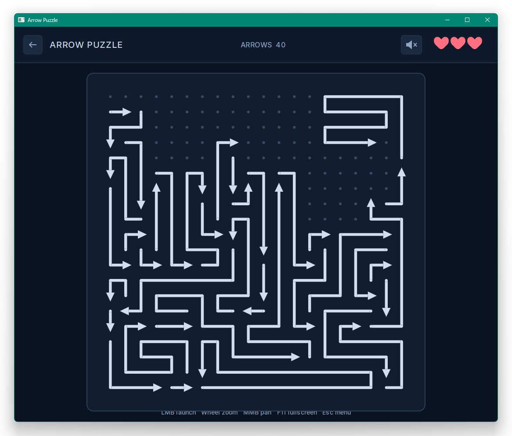
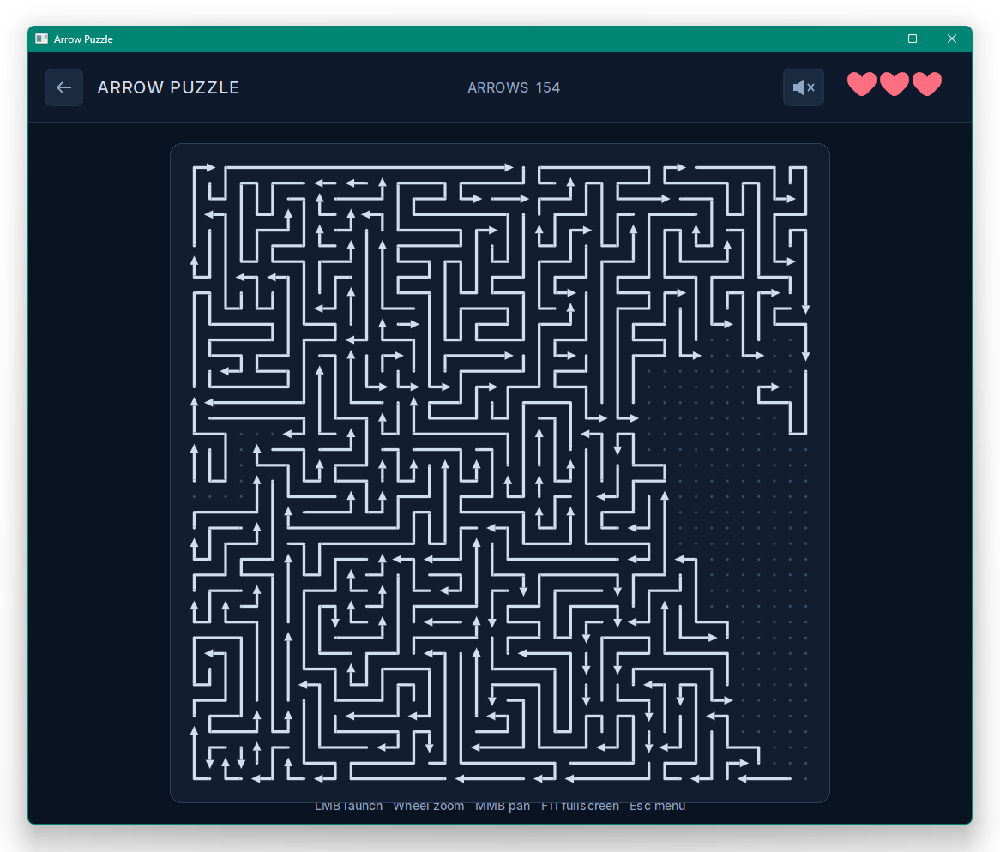
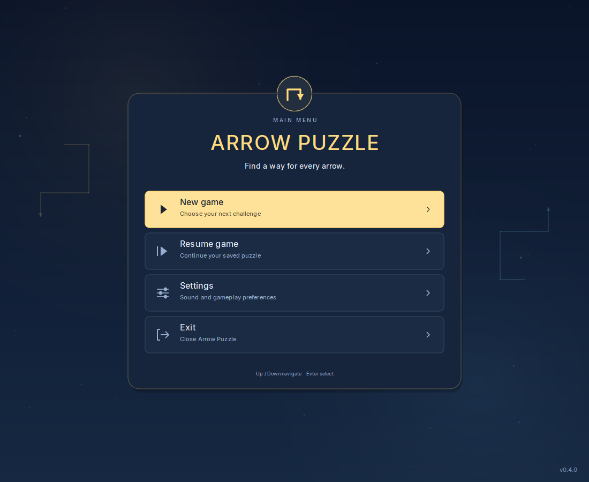
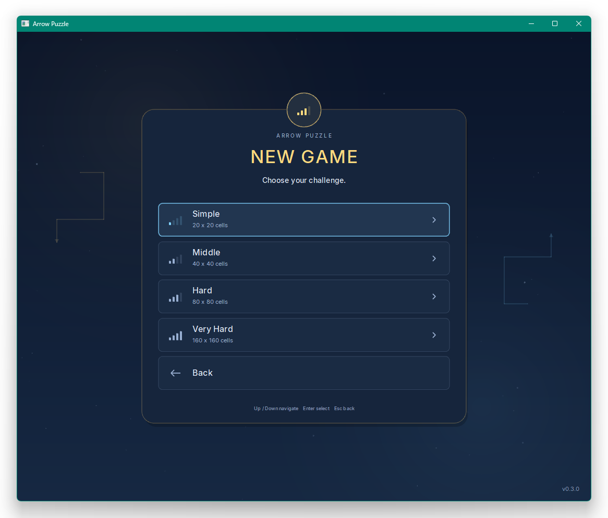
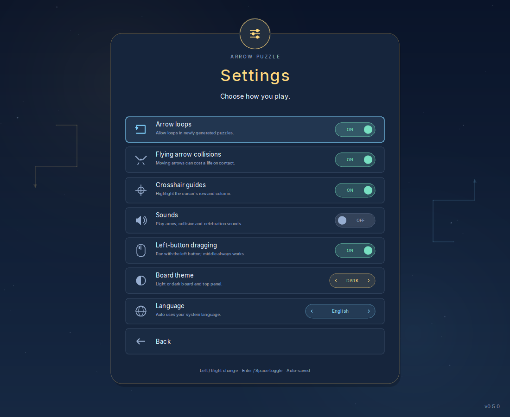
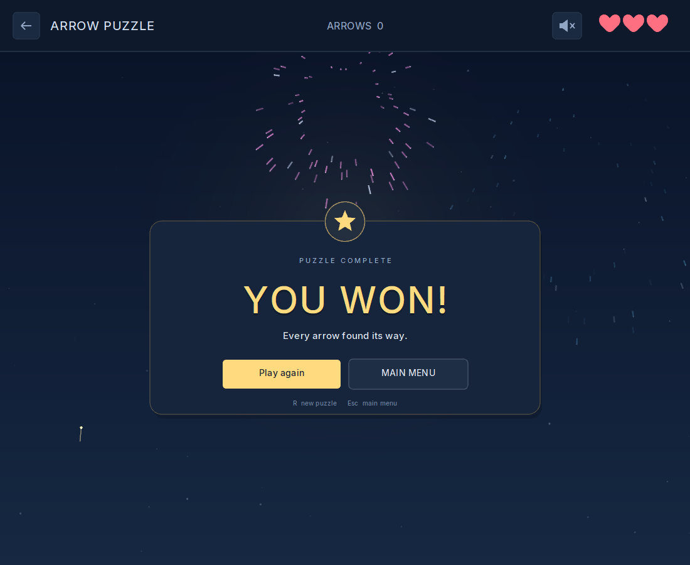
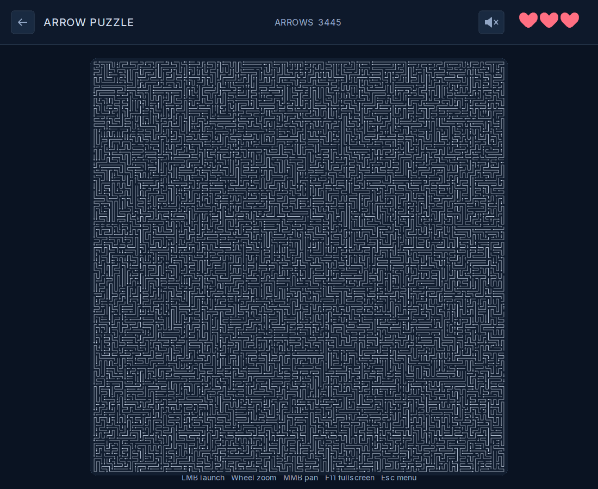

# Arrow Puzzle

[Русская версия](README_RU.md)

Arrow Puzzle is a minimalist desktop puzzle game about untangling a board of
arrows. It is written in C++20 with raylib for Windows and Linux.

Version **0.5.0** adds native Linux packages, ordinary and portable builds,
eight interface languages, rounded arrows, an application icon, and optional
left-button dragging for touchpads. It offers 20 x 20, 40 x 40, 80 x 80, and
experimental 160 x 160 boards, dark and light board themes, optional sounds,
and animated result screens. Ordinary builds use LocalAppData on Windows
and XDG config/data directories on Linux; explicitly labelled portable builds
keep settings and unfinished games beside the executable.

## Screenshots

| Simple level (20 x 20) | Middle level (40 x 40) |
| :---: | :---: |
| [](docs/screenshots/simple-level.png) | [](docs/screenshots/middle-level.png) |

| Main menu | Difficulty selection |
| :---: | :---: |
| [](docs/screenshots/main-menu.png) | [](docs/screenshots/new-game.png) |

| Settings | Victory and fireworks |
| :---: | :---: |
| [](docs/screenshots/settings.png) | [](docs/screenshots/victory.png) |

Very Hard (160 x 160), using the frontier generator introduced in 0.4.0:

[](docs/screenshots/very-hard.png)

## Download

Download [Arrow Puzzle 0.5.0](https://github.com/gugglegum/arrow_puzzle_game/releases/tag/v0.5.0):

| Platform / format | Ordinary | Portable |
| --- | --- | --- |
| Windows x64 / ZIP | [ZIP](https://github.com/gugglegum/arrow_puzzle_game/releases/download/v0.5.0/ArrowPuzzle-0.5.0-windows-x64.zip) | [Portable ZIP](https://github.com/gugglegum/arrow_puzzle_game/releases/download/v0.5.0/ArrowPuzzle-0.5.0-windows-x64-portable.zip) |
| Linux x86-64 / tar.gz | [tar.gz](https://github.com/gugglegum/arrow_puzzle_game/releases/download/v0.5.0/ArrowPuzzle-0.5.0-linux-x64.tar.gz) | [Portable tar.gz](https://github.com/gugglegum/arrow_puzzle_game/releases/download/v0.5.0/ArrowPuzzle-0.5.0-linux-x64-portable.tar.gz) |
| Linux x86-64 / AppImage | [AppImage](https://github.com/gugglegum/arrow_puzzle_game/releases/download/v0.5.0/ArrowPuzzle-0.5.0-linux-x64.AppImage) | [Portable AppImage](https://github.com/gugglegum/arrow_puzzle_game/releases/download/v0.5.0/ArrowPuzzle-0.5.0-linux-x64-portable.AppImage) |

Extract a Windows ZIP and run `ArrowPuzzle.exe` or `ArrowPuzzle-portable.exe`.
Fonts, translations and sounds are embedded; the executable works on its own.
See [Linux startup and data locations](docs/en/LINUX.md) for system requirements,
tar.gz launch instructions and AppImage startup without FUSE.

Each format is available in ordinary and `-portable` variants. Ordinary Windows
builds store `settings.txt` and `savegame.txt` in `%LOCALAPPDATA%\ArrowPuzzle\`.
Portable builds keep both files beside `ArrowPuzzle-portable.exe`,
`ArrowPuzzle-portable`, or the outer `.AppImage` file. The mode is built into
the executable: extracting it alone or renaming it does not change the mode.
The portable directory must be writable. Earlier release assets retain their
original behavior; existing saves are not moved automatically. To continue an
older Windows game in the ordinary build, close the game and copy its adjacent
`settings.txt` and `savegame.txt` into `%LOCALAPPDATA%\ArrowPuzzle\`, or choose
the portable build and keep those files beside its executable.

Release builds are compiled and tested by **GitHub Actions**. Packages include
build metadata, with a common SHA-256 manifest supplied alongside the downloads.
The packages, unpacked executables and manifest have GitHub build-provenance
attestations. See the
[release verification guide](docs/en/RELEASING.md#verifying-a-download).
Changes since 0.4.0 are listed in the [changelog](CHANGELOG.md#050---2026-10-30).

The current build is not digitally signed, so Windows SmartScreen may display
an unknown-publisher warning.

## Gameplay

Every arrow is a polyline made of grid cells. Its head defines the direction
in which the whole body moves, one cell at a time, like the snake in the
classic Snake game.

Click an arrow to launch it. A launched arrow is highlighted in blue, starts
slowly, and accelerates smoothly like a small rocket without a maximum-speed
cap. To remove the arrow, it must leave the board completely. Hitting a
stationary arrow or its own body costs one of the three lives: the failed
arrow turns red, rewinds to its original position, and remains red while idle.
The goal is to clear the board.

Self-collision is evaluated dynamically rather than from a static snapshot.
The head may enter a cell vacated by its own tail on the same movement tick,
but it may not pass through any other part of its body.

Several arrows can move simultaneously. If two moving arrows touch, the batch
costs one life, but both arrows pass through each other and continue forward
instead of rewinding. Both turn red before a half-second hit-stop and remain
red for the rest of their flight, making the contact and lost life clearly
visible before and after movement resumes. Timing is therefore part of the
puzzle.

Every arrow has an independent speed and movement clock. A frame is resolved
chronologically at every cell boundary crossed by any arrow, so even an arrow
that covers several cells in one rendered frame cannot tunnel through an
obstacle. Rendering remains continuous at pixel resolution. Corners stay
orthogonal: the line grows at the head and retracts at the tail without
diagonal warping. A per-frame event budget keeps very large or unusually fast
boards responsive; unfinished simulation time is carried forward, never
replaced by skipped collision checks. A newly clicked arrow is timestamped
after any older queued simulation time, so backlog can never make it inherit
another arrow's speed.

## Current features

- Start menu with 20 x 20, 40 x 40, 80 x 80, and 160 x 160 difficulty presets
- Completely filled generated boards
- Usually about 180 arrows on a 40 x 40 board
- A deliberate mix of short, medium, and long arrows with difficulty-specific
  length limits
- Constructive generation with a stored valid solution order
- A seed-dependent number of spatially distributed opening moves, with wider
  ranges on larger boards
- Up to eight-candidate quality selection with a responsive generation indicator
- Extra preference for complex arrows whose head follows the vacating tail
- Dynamic self-collision and simultaneous moving-arrow collisions
- Optional arrow loops and flying-arrow collision penalties
- Automatic settings/progress storage in user directories or beside portable builds
- Eight embedded interface languages with automatic system-language selection
- Three lives with animated collision recovery
- Subtle grid dots revealed as arrows leave, with optional row and column guides
- Independent, continuously accelerating motion without a speed cap
- Event-driven cell collision checks that prevent high-speed tunnelling
- Dark board theme by default, with a persistent Light option
- Windowed and borderless fullscreen at the desktop resolution
- Pointer-centred wheel zoom, keyboard zoom/fit, and optional left-button panning
  alongside the always-available middle-button drag
  on large boards, including laptops with a touchpad
- Analytic antialiasing for arrows and grid dots at small zoom levels
- Native Windows font smoothing with the embedded Inter typeface
- Optional launch, collision, defeat, victory, and firework sounds
- Mouse-accessible menu and sound buttons in the gameplay HUD
- Animated result screens and victory fireworks
- Redesigned menus with one shared mouse and keyboard selection
- Cached board rendering and no unnecessary GPU redraws while idle
- Deterministic seeds and extensive generator tests
- No ads, telemetry, accounts, or runtime network access

## Controls

| Input | Action |
| --- | --- |
| Left mouse button click | Launch an idle arrow on release |
| Left mouse button + drag | Pan from an arrow or empty space when Left-button dragging is ON (default) |
| Mouse wheel | Zoom at the pointer |
| Ctrl + + / Ctrl + - | Zoom at the centre of the visible gameplay area |
| Ctrl + 0 | Fit and centre the whole board in the window |
| Middle mouse button + drag | Pan the board |
| Up / Down | Move the current menu selection |
| Left / Right | Change the selected board theme or interface language |
| Enter | Activate the selected menu item |
| Space | Change the selected setting, including theme and language |
| Top-left back arrow | Save the unfinished game and return to the menu |
| HUD speaker button | Toggle sound |
| HUD lightbulb button | Highlight a random safe arrow after 20 seconds without progress |
| F11 or Left Alt+Enter | Toggle fullscreen |
| Escape | Leave fullscreen, return to the menu, or close the main menu |
| R | Generate a new board when no arrow is moving |

Ctrl + = also zooms in without Shift. The numeric keypad's +, - and 0 work
with either Ctrl key; holding a zoom shortcut repeats it. A left-button drag
starts after moving more than 6 screen pixels and cancels the arrow launch
for that press, even if you return to the starting point before releasing.
Small pointer movements still count as a click when released over the same
arrow. Presses on the top-panel buttons keep their normal button behaviour.
Turn **Left-button dragging** OFF in Settings to pan only with the middle mouse
button. Left drags then leave the board stationary and still cancel arrow launches;
ordinary left clicks continue to launch arrows. The control hint follows this setting.

New arrows may be launched while other arrows are moving forward. Input is
temporarily locked while collided arrows are paused or rewinding.

## Menus, settings, and saves

Version 0.5.0 includes **Language** in Settings. Use the side arrows or
Left/Right keys to cycle through Auto, English, Español, Français, Deutsch,
Português, 简体中文 (Simplified Chinese), Русский and Українська. Enter/Space
also advances the selection. Changes apply immediately and save automatically.
Auto is the default: it follows the Windows UI language or Linux message
locale and uses English when that language is unsupported. Translations and
all required fonts are embedded, so language switching works offline with
the executable alone.

The New game menu provides four board sizes:

- Simple: 20 x 20
- Middle: 40 x 40
- Hard: 80 x 80
- Very Hard: 160 x 160

Very Hard is experimental. Version 0.4.0 replaces its large search
tables with bounded construction from multiple fronts, using up to four workers
to compare eight candidates. It favors arrows connecting the perimeter to the
interior while retaining 6..10 opening moves. The animated generation overlay
remains responsive while candidates are compared.

The Settings menu can prevent newly generated levels from using dynamic arrow
loops and can disable life penalties for collisions between flying arrows.
Existing saved geometry is never rewritten by a settings change. Stationary
obstacles remain active in both collision modes. Changes are written
immediately to `settings.txt`. Disabling arrow loops makes generation more
restrictive; the experimental Very Hard preset can reject a seed and offer a
retry instead of falling back to a simpler board.

**Crosshair guides** highlight exposed dots along the row and column nearest
the pointer. **Sounds** enables the embedded effects; the HUD speaker button
changes the same preference. **Left-button dragging** enables touchpad-friendly
panning; the middle mouse button always pans. All five options (Arrow loops,
Flying arrow collisions, Crosshair guides, Sounds, and Left-button dragging) default to ON when `settings.txt` or
the corresponding key is missing; explicitly saved OFF values are preserved.
**Board theme** defaults to Dark and can be switched to Light; it affects the
board and HUD, while menus and result screens stay dark. Its selector turns
light when Light is chosen. These preferences are also saved in `settings.txt`
and remain compatible with older settings files.

Hovering a menu item selects it. The selection stays in place when the pointer
leaves the item or crosses a gap. Arrow keys navigate from the current item,
even with the pointer resting on another row, until the mouse moves again.

Use the back-arrow button beside the game title or Escape to visit the menu,
change settings, and return through **Resume game**. Clearing the board shows
**YOU WON!** with fireworks; losing all three lives shows **GAME OVER**. The
celebration ends automatically and the finished game returns to idle.

When the game returns to the menu or exits with an uncleared board and at
least one life remaining, it writes `savegame.txt`. The save contains the
complete geometry, remaining and failed-arrow flags, and life count; it does
not depend on a seed or the current generator implementation. Resume game is
disabled when there is no valid unfinished game. Both text files are stored
in the same directory as `ArrowPuzzle.exe`.

## Building on Linux

On Linux Mint / Ubuntu with the [build dependencies](docs/en/LINUX.md) installed:

```bash
./tools/build-linux.sh
./build/linux/arrow_puzzle
```

Development tar.gz and AppImage packages are available from successful
[Build and test runs](https://github.com/gugglegum/arrow_puzzle_game/actions/workflows/build.yml).
See the [Linux guide](docs/en/LINUX.md) for checksums, runtime requirements and
AppImage startup without FUSE.

## Building on Windows

### Requirements

- A Visual Studio installation with the MSVC x64 C++ tools and Windows SDK
  (tested with Visual Studio 2022)
- CMake 3.24 or newer
- Ninja
- Git and an internet connection for the first configuration

The build helper looks for CMake and Ninja in `PATH`. If they are not found,
it tries the standard bundled-tool locations used by CLion. raylib does not
need to be installed manually: CMake downloads the pinned raylib 5.5 source
during the first configuration and builds it statically.
At build time the bundled Inter font is converted to C++ data and linked
directly into the executable. The finished game neither depends on fonts
installed in Windows nor needs a separate runtime asset directory.

### One-command Release build

Run this from the repository root in a regular PowerShell window:

```powershell
powershell -NoProfile -ExecutionPolicy Bypass `
    -File .\tools\build-windows.ps1 `
    -Configuration Release
```

The helper configures the project, builds it, and runs the complete test suite.
The generator stress test creates 1,333 boards and can take several minutes.

The resulting executable is:

```text
build\windows-msvc\arrow_puzzle.exe
```

Launch it with:

```powershell
& .\build\windows-msvc\arrow_puzzle.exe
```

For a Debug build:

```powershell
powershell -NoProfile -ExecutionPolicy Bypass `
    -File .\tools\build-windows.ps1 `
    -Configuration Debug
```

### CMake presets

From a Developer PowerShell with CMake and Ninja in `PATH`:

```powershell
cmake --preset windows-msvc
cmake --build --preset windows-msvc
ctest --preset windows-msvc
```

### Focused generator test

The helper can reproduce a smaller deterministic seed range:

```powershell
powershell -NoProfile -ExecutionPolicy Bypass `
    -File .\tools\build-windows.ps1 `
    -Configuration Release `
    -SeedCount 25 `
    -FirstSeed 700
```

This example checks standard seeds 700 through 724, plus a smaller set of
alternate board configurations.

## Development hooks

Screenshot and scenario hooks are compiled only in Debug. Release and
RelWithDebInfo builds ignore these variables and have no screenshot keyboard
shortcut. Build the Debug configuration explicitly:

```powershell
cmake --preset windows-msvc-debug
cmake --build --preset windows-msvc-debug --parallel 2
```

The initial board can be reproduced without changing the source:

```powershell
$env:ARROWPUZZLE_SEED = "747"
& .\build\windows-msvc-debug\arrow_puzzle.exe
```

For automated visual checks, set `ARROWPUZZLE_SCREENSHOT` to an output path.
The game captures a frame and exits automatically:

```powershell
$env:ARROWPUZZLE_SEED = "747"
$env:ARROWPUZZLE_SCREENSHOT = "$PWD\preview.png"
& .\build\windows-msvc-debug\arrow_puzzle.exe
```

Additional screenshot-only hooks are available:

- `ARROWPUZZLE_DIFFICULTY` selects preset `1` through `4`
- `ARROWPUZZLE_SCREENSHOT_MENU` captures main/new-game/settings menu `1..3`
- `ARROWPUZZLE_SCREENSHOT_FRAME` selects the captured frame (default: `30`)
- `ARROWPUZZLE_SCREENSHOT_REMOVE` hides the first N arrows before capture
- `ARROWPUZZLE_SCREENSHOT_LAUNCH` launches one arrow by zero-based index
- `ARROWPUZZLE_SCREENSHOT_LAUNCH_2` launches a second arrow later
- `ARROWPUZZLE_SCREENSHOT_LAUNCH_2_FRAME` selects that launch frame

## Project structure

```text
include/arrow/       Public C++ headers
assets/fonts/        Inter UI font source and its OFL license
assets/sounds/       Embedded game and firework sound sources
cmake/               Font/audio embedding and build-version helpers
src/Board.cpp        Board state, movement rules, and solution checks
src/Generator.cpp    Constructive level generator and candidate scoring
src/FrontierGenerator.cpp  Bounded Very Hard generation from both directions
src/MotionKinematics.cpp  Independent accelerated movement calculations
src/MotionResolver.cpp  Moving/static collision classification
src/Persistence.cpp  Versioned settings and unfinished-game storage
src/Game.cpp         raylib rendering, input, and animation
src/StaticBoardGeometry.cpp  Cached geometry and analytic antialiasing
src/UiText.cpp       Native Windows font smoothing and text cache
src/MenuScreen.cpp   Menu presentation
src/MenuSelection.hpp  Shared mouse and keyboard menu selection
src/EndScreen.cpp    Result cards and finite victory celebration
src/GameAudio.cpp    Optional embedded sound effects
tests/               Core, persistence, menus, and result-screen tests
tools/               Windows/Linux build, packaging and smoke helpers
docs/en/             English developer guides
docs/ru/             Russian developer guides
docs/screenshots/    Shared screenshots
.github/workflows/   Development checks and common release/provenance
```

`arrow_core` contains the board and generator without a raylib dependency.
`arrow_puzzle` links that core with statically built raylib. `arrow_tests`
links only `arrow_core`.

Detailed developer and AI-assistant documentation is indexed in
[`docs/en/README.md`](docs/en/README.md). It covers the architecture, generator,
runtime simulation, collisions, persistence, and safe change workflows.

## How generation works

The generator builds a maze-like Hamiltonian cycle that visits every board
cell. Simple, Middle and Hard use dynamic programming to cut it into arrows
with a broad length distribution. A cut is accepted only when its exit
dependencies preserve a constructive solution order.

Since 0.4.0, Very Hard removes escapable fragments from either
direction and records that removal order as the solution. Compact per-cell
state replaces the large count/length tables. Short arrows can occupy at most
20% of the perimeter; at least 75% of it must belong to arrows entering the
interior. Loopless boards meet the same quality limits. See the
[generator guide](docs/en/GENERATOR.md#11-large-board-frontier-construction-040)
for the bounded search and reproducible benchmark.

For the path cutter, ray exits and dynamic self-passes are cached once per
opened cycle. Large boards use exact range-based reachability and reconstruction instead of dense
area-by-arrow-count tables, while dependency choices are updated through a
reverse graph. Independent candidate attempts run in parallel and are compared
in deterministic order.

Multiple candidates are scored for inter-arrow contact, spatial mixing,
direction diversity, turns, dependency structure, and length distribution.
All four presets compare up to eight candidates. Independent candidates are
generated in parallel before the highest-scoring eligible tangle is selected.
`GeneratorOptions::candidateAttempts` is the internal quality/time control that
can later be exposed as a menu setting.

An exact dynamic self-pass receives an additional score: the head reaches one
of its own body cells on precisely the simulation tick when that cell is
vacated by the moving tail. Longer and more complex versions receive a further
bonus. This favours deceptive thread-like arrows without permitting real
self-collisions.

Large rectangular S-shaped regions are penalized so the result resembles a
tangle of separate threads rather than a few territorial snakes.

Generation runs on a background thread. The game remains responsive and shows
an animated overlay while candidates are evaluated. There is deliberately no
simple serpentine fallback: if no valid candidate can be found, the game shows
an error and allows another attempt. The current Hamiltonian-cycle constructor
requires even board dimensions.

The automated suite verifies complete coverage, geometry, requested length
limits, constructive solvability, dynamic self-collision, and statistical
quality across many deterministic seeds.

Seeds are development and reproduction aids, not the save format. Saved games
contain the complete arrow geometry and current gameplay state, so partially
solved levels remain stable across generator versions and platforms.

## Portability

Windows x64 remains the main development platform. Native Linux x86-64 builds
use X11/XWayland and OpenGL 3.3; see [Linux build and testing](docs/en/LINUX.md).
The first native checks were performed on Linux Mint 22.3 inside VMware. Native
Wayland, Android, other architectures and broader desktop coverage remain work
for later. Version 0.5.0 provides ordinary and portable tar.gz/AppImage packages.

In ordinary Linux builds, settings live in `~/.config/arrow-puzzle/settings.txt` and progress in
`~/.local/share/arrow-puzzle/savegame.txt` (absolute XDG overrides are respected).
Ordinary Windows builds keep both files in `%LOCALAPPDATA%\ArrowPuzzle\`.
Portable builds on either OS keep both beside the executable (beside the outer
file for AppImage). Their text formats are unchanged; copy the two files while
the game is closed to transfer progress between variants or platforms.

## License

Arrow Puzzle is released under the [MIT License](LICENSE), copyright
2026 Paul Melekhov.

raylib 5.5 is distributed under the unmodified zlib/libpng license and is
compatible with static linking in this MIT-licensed project. See
[Third-Party Notices](THIRD_PARTY_NOTICES.md) for its copyright and license
text.

The bundled Inter 4.1 font remains under the SIL Open Font License 1.1. Its
complete license is stored in
[`assets/fonts/Inter-LICENSE.txt`](assets/fonts/Inter-LICENSE.txt).

The embedded Arrow Puzzle CJK font is a renamed Noto Sans SC subset under the
same SIL OFL 1.1; see [its license](assets/fonts/NotoSansSC-LICENSE.txt).
Font reproduction is documented in `assets/fonts/README.md` in the source repository.
